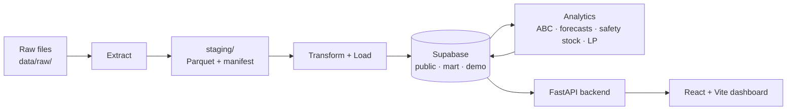

# SSM Decision Support Dashboard (DSD)

A decision support dashboard that replaces San San Marketing's blanket
three-week safety-stock rule with data-driven, per-product replenishment
recommendations.

## Overview

San San Marketing (SSM), an FMCG distributor in Urdaneta, Pangasinan, orders
and holds stock for every product under one rule: about three weeks of
safety stock, however fast or slow the product moves. That traps working
capital in slow movers and still leaves fast, perishable products short.

The DSD replaces that rule with a pipeline: rank products by their share of
revenue (ABC/Pareto), forecast next month's demand for the top sellers,
derive each product's safety stock and target stock from its own forecast,
then plan how much to order with a multi-objective linear program (cost
0.45, service level 0.35, storage 0.20). The dashboard presents all of it in
plain language for SSM's staff, from "how have sales and stock changed" down
to "what should we order now".

Scope is two principals, **Unilever Philippines** and **Del Monte
Philippines**, and they are not treated the same way:

- **Unilever** has real sales per product (SKU) per month, so it gets the
  whole pipeline: classes, forecasts, safety stock and an order plan.
- **Del Monte** has no product-level sales at all. Its sales register is
  invoice-level, and its monthly sell-out is by product category only. It is
  ranked and charted by category, and the cards that need per-product
  forecasts (safety stock, order plan, forecast accuracy) are empty for it
  on purpose (DEC-03 in [`ARCHITECTURE.md`](ARCHITECTURE.md)).

## Pipeline



Every stage runs against SSM's real files and the live Supabase database.
Each stage is still started by hand (for example
`scripts/run_baseline_forecast.py`, then `scripts/run_lp.py`); there is no
automatic end-to-end run.

**Forecasting.** A router picks each product's method from how many months
of sales it has (`analytics/forecasting/router.py`):

| Sales months | Method served |
|---|---|
| fewer than 3 | provisional trailing average |
| 3 to 11 | 3-month moving average (MA3) |
| 12 to 23 | TSB (for intermittent demand) |
| 24 or more | average of the global XGBoost model and MA3 |

MA3 is computed for every product as the benchmark. On real Top-seller
data, TSB and the XGBoost+MA3 average tie with MA3; they are served because
they use each product's full history, not because they were shown to be
more accurate. The forecast run stored on 2026-10-05 served 189 products:
104 with the XGBoost+MA3 average, 37 with MA3, 34 with TSB, 9 with a
trailing average and 5 with no order.

## Getting started

### Prerequisites

- Python 3.13 (`.python-version`). 3.12 also works; on 3.11 install
  `xgboost==3.2.0` instead of the pinned version.
- Node.js and npm for the frontend (React 19, Vite 8, Recharts 3).
- Access to the team's Supabase project (connection strings go in `.env`).

### 1. Clone

```bash
git clone <repo-url>
cd <repo-folder>
```

### 2. Install dependencies

```bash
pip install -r requirements.txt
cd frontend && npm install && cd ..
```

### 3. Create `.env`

Copy [`.env.example`](.env.example) to `.env` and fill it in. `.env` is
git-ignored; never commit it.

| Setting | What it is for |
|---|---|
| `SUPABASE_DB_URL`, `SUPABASE_DIRECT_URL`, `SUPABASE_KEY` | The database (pooler on port 6543; the direct URL on 5432 when 6543 is blocked) |
| `JWT_SECRET_KEY`, `JWT_ALGORITHM`, `JWT_EXPIRY_HOURS` | Sign-in tokens |
| `CORS_ALLOWED_ORIGINS`, `FRONTEND_URL` | Which frontend may call the API, and where email links (and the emails' hosted hero picture, `frontend/public/email/`) point. Unset, `FRONTEND_URL` falls back to `http://localhost:5173` in development; with `APP_ENV=production` it must be set, or no link is built and the admin is told why |
| `SMTP_HOST`, `SMTP_PORT`, `SMTP_USER`, `SMTP_PASSWORD`, `SMTP_FROM` | Invitation and password-reset emails |
| `MFA_ENCRYPTION_KEY`, `MFA_REQUIRED_ROLES`, `MFA_ENABLED` | Two-step sign-in. Paused unless `MFA_ENABLED=true`; every server must share the same key |
| `DM_DEMO_ENABLED` | Serves the labelled synthetic data behind the dashboard's "Include synthetic data" switch. Off by default (see below) |
| `APP_ENV` | `production` hides the API's `/docs` pages |

### 4. Run the backend and the frontend

```bash
python -m uvicorn backend.main:app --host 127.0.0.1 --port 8000
```

```bash
cd frontend
npm run dev -- --port 5173
```

Open http://localhost:5173. The frontend calls `VITE_API_URL`, which
defaults to `http://localhost:8000`.

### 5. Check the API

```bash
python scripts/smoke_api.py
```

Read-only and quick: it calls every route the frontend uses, for each
principal, against the live database. All PASS means a broken page is a
frontend problem.

### 6. Run the tests

```bash
pytest tests/
cd frontend && npm test
```

Tests keep `DM_DEMO_ENABLED` off unless a test turns it on itself, so a
local `.env` with the switch on does not change their results.

### 7. Re-run the pipeline (only when the data changes)

`data/raw/` and `staging/` are git-ignored: SSM's files are never
committed. Copy the shared "SAN SAN Marketing" folder into `data/raw/`,
keeping its `Del Monte`, `SSIS` and `Unilever` subfolders, then:

```bash
python -m analytics.etl.extract.driver
```

Database changes are made only through the numbered migrations in
`analytics/db/migrations/` (the latest is 0057; the next free number is
0058) and `scripts/run_canonical_load.py`, after a backup.

## Real data and synthetic data

The dashboard has a switch in the top bar, **Include synthetic data**.

- **Off (the default):** every page shows SSM's real data only. Models read
  the `_Real` views (`Unilever_SKU_Demand_Fact_Real`, `SellOut_Fact_Real`,
  ...), which leave out every generated row.
- **On:** charts add clearly labelled synthetic (generated) data from the
  `demo` schema: Unilever's Jan 2021 – Dec 2022 back-cast, and Del Monte's
  months SSM did not collect, its Jan 2025 change of categories and its
  2021–22 back-cast. Generated months are drawn dotted or hatched and say how
  they were made. They never feed real KPIs, forecasts, ABC classes or the
  real order plan, and never appear in the manuscript.
- The switch works only on a server with `DM_DEMO_ENABLED=true`. Elsewhere
  it is greyed out.

Rules behind the numbers (detail in [`docs/DEMO_DATA.md`](docs/DEMO_DATA.md)):

- **No real data before January 2023**, for either principal.
- **Unilever:** a month with no sales row means the product sold nothing.
  It is shown as zero ("No sale this month") and never filled in.
- **Del Monte:** a missing month is a collection failure ("Not collected"),
  never zero. Real sell-out covers 17 of the 36 months from January 2023 to
  December 2025: nothing was collected from March 2024 to February 2025, or
  in 7 other months.
- Each chart point that is zero or empty carries its reason, explained under
  the chart.

## Deployment

- Frontend: Vercel (`frontend/vercel.json`).
- Backend: Render, Python 3.13.
- Both deploy from a branch on GitHub. Set the same `.env` values on Render,
  including `MFA_ENCRYPTION_KEY` and, to offer the switch, `DM_DEMO_ENABLED`.

## Troubleshooting

**A page breaks after you pull.** Run `python scripts/smoke_api.py` first.
All PASS means the problem is in the frontend; see
[`reports/FRONTEND_HANDOFF_2026-09-20.md`](reports/FRONTEND_HANDOFF_2026-09-20.md).

**The sidebar says SYS OFFLINE but data loads.** An ad blocker (Brave or
uBlock's EasyPrivacy list) blocks `onrender.com/health`. Allow it or ignore
the label.

**Database connections hang on some networks.** Port 6543 (the pooler) is
blocked on some networks; use the direct URL on port 5432 for read-only
checks.

**The "Include synthetic data" switch is greyed out.** The server has
`DM_DEMO_ENABLED` off. Set it to `true` and restart the backend; it reads
`.env` only at start.

**Known issue (2026-10-16): forecasts with the demo switch on.** With
`DM_DEMO_ENABLED=true`, `GET /forecast/{sku}` serves the demonstration
series and forecast for Unilever products even when the dashboard's switch
is off. A fix is in progress on `kelvin-etl`. Until it lands, keep the
setting off on any server where real forecasts must show.

**Known issue (2026-10-16): 98 failing backend tests.** The fake database in
`tests/backend/test_dashboard.py` and `test_dashboard_range.py` does not yet
answer the new "was anything collected in this range" query
(`backend/marts.py`, `principal_collected`). The app itself is unaffected.
In the same run, the dashboard, recommendation, demo, LP and data-mode
suites passed 326 tests.

**`No module named 'xgboost'` or `'lxml'`.** Re-run
`pip install -r requirements.txt`.

**A file family stages 0 rows.** Check the file sits in its principal's
subfolder and keeps its exact name. `unilever_sku` needs
`UnileverLaUnionSalesperSKU2023to2026.xls` inside `data/raw/Unilever/` (it
is an MHTML file with an `.xls` extension).

## Repository structure

```
analytics/        The batch pipeline (installable Python package)
  etl/              Extract (one parser per file family), Transform, Load
  classification/   ABC/Pareto classification
  forecasting/      Router, MA3, TSB, global XGBoost model, category trends
  optimization/     Safety stock, target stock and the LP
  demo/             The labelled synthetic demonstration (back-cast, stock, plans)
  db/               schema.sql and the numbered migrations
backend/          FastAPI app: authentication, permissions, routers, marts
frontend/         React + Vite dashboard
  src/components/   Dashboard, SKU Forecast, Category Trends, SKU Management,
                    ABC Classification, Reorder Recommendations, Audit Log,
                    Data Management, User Management
config/           Column maps, source-of-truth rules, alias tables
scripts/          Runners: load, forecast, LP, demo builds, smoke test
docs/             DEMO_DATA.md (synthetic data rules), ERD assets
reports/          Audits, diagnostics and hand-off notes
tests/            pytest suites (backend, analytics, demo)
data/raw/         SSM's source files: git-ignored, never committed
ARCHITECTURE.md   Decision register (DEC-01 onward), stage contracts, known gaps
CLAUDE.md         Working rules for the codebase
```

## Project status (2026-10-16)

- Real data for both principals is loaded in Supabase. The dashboard reads it
  through data marts (schema `mart`), and every frontend route passes the
  smoke test.
- Unilever Top sellers (Class A as of Feb 2026): 189 products, forecast on
  2026-10-05. The March 2026 plan has 97 pending recommendations.
- The order plan's cost and capacity inputs are placeholders until SSM
  confirms procurement cost, storage cost, warehouse capacity and supplier
  ceilings.
- The Top-seller basis (Class A over the last 12 months, plus new products
  that are Class A over the last 3) awaits the technical adviser's
  confirmation (DEC-38).
- The labelled synthetic demonstration (migrations 0052–0057) is in the
  database behind `DM_DEMO_ENABLED`. Its newest cards (demo stock, demo order
  plans) are served by the API but not yet drawn on the dashboard.
- Two-step sign-in is built and paused by default (`MFA_ENABLED`).

## Key decisions

The full register is in [`ARCHITECTURE.md`](ARCHITECTURE.md). The ones that
surprise people:

- **Grain differs per principal (DEC-03).** Unilever per product, Del Monte
  per category. Del Monte's data cannot support product-level numbers.
- **One source of truth per fact per principal (DEC-04).** Files that
  overlap are staged for audit, but only one view of each fact is loaded.
- **Models read the `_Real` views, never the base tables.** Generated rows
  are excluded by the view itself, so mixing real and synthetic data is not
  something a caller can forget to filter.
- **No invented numbers.** When a figure cannot be computed (too little
  history, a model error), the page says why instead of showing a stand-in
  value.
- **Human review gates** between pipeline stages: work does not move to the
  next stage without a review.

## Team

**4ISA Capstone Group 7**, BS Information Systems (IS-BA track), College of
Information and Computing Sciences, University of Santo Tomas. Capstone,
2025–2026. Client: San San Marketing.

| Member | Role |
|---|---|
| Kelvin (Yuan) | ETL, database schema, Supabase, orchestration, pipeline decisions, demonstration data, frontend integration (`kelvin-etl` branch) |
| Maica | Frontend, authentication, deployment, backend |
| Audrey | Backend endpoints, backend and frontend, LP |
| Thea | Models, manuscript, SSM liaison, frontend design |
