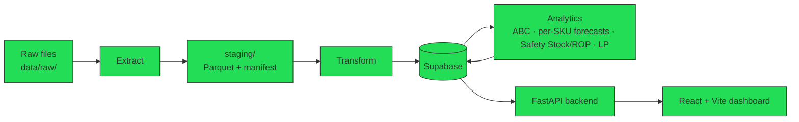

# SSM Decision Support Dashboard

A decision support dashboard that replaces SSM's blanket three-week
safety-stock rule with per-SKU replenishment recommendations.

## Overview

San San Marketing (SSM) currently orders and holds inventory for every
SKU under one blanket rule: three weeks of safety stock, regardless of
how fast or slow that SKU actually moves. This ties up working capital on
slow movers and still causes Bad Orders (stockouts/spoilage) on fast,
perishable ones — the rule doesn't distinguish between them.

This project replaces that rule with a per-SKU pipeline: classify SKUs by
revenue contribution (ABC/Pareto), forecast demand for the highest-priority
tier, derive a safety stock and reorder point from that forecast, then
optimize how much of the manufacturer's allocation to actually accept
against three competing objectives (holding cost, service level,
spoilage cost) using linear programming.

Scope is two principals — **Unilever Philippines** and **Del Monte
Philippines** — and they are not treated the same way. Unilever's data
supports real per-SKU demand (a dedicated SKU-level sales file exists).
Del Monte's does not — its sales data is invoice-level only, with no SKU
column anywhere in that file family, so allocating a monthly total down
to SKU would be fabricating a number the data doesn't support. Del Monte
is forecast at **category grain** instead. This asymmetry is a deliberate
project decision (DEC-03 in `ARCHITECTURE.md`), not an inconsistency —
it trips people up if they assume both principals work the same way.

## Pipeline



🟢 Runs against real SSM files and the live Supabase database (as of 2026-09-21) — Raw files, Extract, staging/, Transform, Supabase, Analytics (ABC, per-SKU forecasts, safety stock/ROP, LP), FastAPI, dashboard.
🟡 Every stage is still started by hand (e.g. `scripts/run_baseline_forecast.py`, `scripts/run_lp.py`) — there is no automatic end-to-end run yet.

## Getting Started

### Prerequisites

- Python 3.12+ (developed and tested on 3.13). The pinned `xgboost==3.4.1`
  requires 3.12 or newer. On Python 3.11, install `xgboost==3.2.0` instead —
  the newest release that still supports 3.11.
- No system-level dependencies beyond Python and pip

### 1. Clone and check out the real trunk

```bash
git clone <repo-url>
cd Capstone-Project
git checkout group7/kelvin-etl
```

`master` is a stub trunk — none of the real ETL, Transform, or backend
work has been merged into it yet. Work off `group7/kelvin-etl`, which is
where all real work actually lives.

**Corrected 2026-09-20.** This used to say `AUDREY-TRY-MERGE`. That branch
still exists but was last updated 2026-08-17 and is **197 commits behind**
`kelvin-etl`, with nothing unique to it (`git rev-list --left-right --count
AUDREY-TRY-MERGE...kelvin-etl` returns `0  197`). Checking it out put you a
month back. Everything it had is already in `kelvin-etl`.

### 2. Install dependencies

```bash
pip install -r requirements.txt
```

`lxml` was added 2026-08 — required to parse the Unilever La Union file,
which is actually an MHTML web archive despite its `.xls` extension. If
you installed before this date, re-run the command above even if you
think you're already set up.

`xgboost` became a pipeline dependency on 2026-09-21 — the long-history
forecasts (`analytics/forecasting/global_model.py`) use it. If you set up
before then, re-run the install; without it the forecasting tests and
`scripts/run_baseline_forecast.py` fail with `No module named 'xgboost'`.

### 3. Get the source data in place

`data/raw/` and `staging/` are both gitignored — neither client files nor
Extract's output are ever committed. Everyone on the team has the same
shared "SAN SAN Marketing" folder; copy it in, keeping the subfolder
structure:

```bash
cp -r "SAN SAN Marketing/Del Monte" "data/raw/Del Monte"
cp -r "SAN SAN Marketing/SSIS" "data/raw/SSIS"
cp -r "SAN SAN Marketing/Unilever" "data/raw/Unilever"
```

`UnileverLaUnionSalesperSKU2023to2026.xls` must end up inside
`data/raw/Unilever/` specifically. Without it, the `unilever_sku` family
stages 0 rows and looks broken even though the code is fine — it's a
missing-file problem, not a bug, but it's easy to mistake for one.

### 4. Run Extract

```bash
python -m analytics.etl.extract.driver
```

Takes a few minutes — the real corpus is 1,000+ sheets across 194 files.
You'll know it worked when the output ends with something like:

```
Staged 1042 sheet(s) across 7 families to .../staging
Sheets scanned: 1042
Staged: 1042
Rejected: 0
```

This writes `staging/_manifest.json`, `staging/_extract_qc.md`, and one
Parquet file per staged sheet.

### 5. Run the tests

```bash
pytest tests/ -v
```

Expected as of 2026-09-23: **554 passed / 8 skipped / 0 failed** (with
`xgboost` installed and `.env` pointing at the live database). The old
`Users` vs `users` casing failures are fixed. Any failure now means
something is wrong — see Troubleshooting.

If you see tests skipping that you expected to run, it almost always means
step 3 or step 4 wasn't done yet — several tests are gated on `data/raw/`
or `staging/` actually existing. (This step previously said "109 passed",
which pre-dated the backend and analytics suites.)

## Troubleshooting

**The dashboard breaks after you pull.** Run `python scripts/smoke_api.py` first
(read-only, ~10s, writes nothing). It drives all 17 frontend-facing routes
against the live database and tells you whether the fault is backend or
frontend. All PASS means the bug is in the frontend — see
[reports/FRONTEND_HANDOFF_2026-09-20.md](reports/FRONTEND_HANDOFF_2026-09-20.md)
for the diagnosis, the Del Monte null shapes, and the known gotchas.

**Forecasting tests fail to import (`No module named 'xgboost'`).** Re-run
`pip install -r requirements.txt` — see step 2 for the Python 3.11 case.

**`test_abc_schema_contract` lists key columns several times.** Fixed
2026-09-21: the live database also holds experiment schemas
(`ssm_abc_repro`, `ssm_synth_v2`, `ssm_abc_phase2`) with copies of the
tables, and the test now reads only `public`.

**A family stages 0 rows.** Check two things: the file is under the
subfolder its principal implies (Del Monte / SSIS / Unilever), and its
filename matches what the driver looks for. `unilever_sku` in particular
needs the exact file `UnileverLaUnionSalesperSKU2023to2026.xls` inside
`data/raw/Unilever/` — see step 3 above.

**`daily_sales_report` always stages 0 rows.** This is expected, not a
bug. No files in the current corpus match the real daily-report naming
convention ("DAILY SALES REPORT MM.DD.YYYY.xlsx") — the folders named
"DAILY REPORT - ..." under `data/raw/Del Monte/` are actually ordinary
monthly Sales Register files under a misleading folder name.

**Tests skip unexpectedly.** `data/raw/` or `staging/` isn't populated —
redo steps 3 and 4 before assuming something's broken.

**`ModuleNotFoundError: No module named 'lxml'` when parsing the
Unilever file.** You installed dependencies before 2026-08 — re-run
`pip install -r requirements.txt`.

## Repository structure

```
analytics/            Installable Python package — the full batch pipeline
  etl/                 Extract, Transform, Clean, Load, granularity resolution
    extract/           One parser module per source file family (7 families)
  classification/      ABC/Pareto SKU classification
  forecasting/          SARIMA demand forecasting
  optimization/         Safety stock, ROP, and LP replenishment optimization
  db/                    schema.sql, SQLAlchemy models, date-dimension seeder
  _coerce.py             Shared numeric-parsing helpers (Extract + Transform)

backend/               FastAPI app — routers and Pydantic schemas exist for
                        5 endpoint groups; each currently returns a stub
                        response, not connected to Supabase yet

frontend/              Vite + React dashboard — login, sidebar, and pages for
                        ABC Classification, SKU Forecast, Reorder
                        Recommendations, Warehouse Movement, Bad Orders,
                        Data Upload, SKU Management

config/                column_maps/*.yaml (per-doc-type header mappings),
                        source_of_truth.yaml (DEC-04 dedup rules),
                        alias_tables/ (label normalization)

profiling/              File-format detection and header-sniffing primitives
                        Extract's parsers are built on

data/
  raw/                   Source xlsx/csv files — gitignored, never committed
  interim/, processed/   Currently empty — not yet used by any pipeline stage

staging/                Extract's output — gitignored, regenerated locally
                        (_manifest.json, _extract_qc.md, one Parquet per sheet)

tests/                  pytest suite, mirrors the analytics/ package structure

docs/erd/               Entity-relationship diagram assets

ARCHITECTURE.md         The actual technical source of truth — architecture
                        decisions, stage contracts, known gaps, change log
```

## Project status

As of 2026-08, from an actual `pytest tests/ -v` run (**109 passed**, 0
failed) and a real Extract run against the full corpus:

**Extract — runs today, verified against real data.**
1,042 sheets staged across 7 document families, 0 rejects. 4 checksum
mismatches flagged (confirmed to be errors in SSM's own source
spreadsheets — stale `SUM()` formula ranges — not Extract bugs).

**Transform — implemented and tested, no orchestrating driver yet.**
Individual functions (`transform_fact`, `apply_column_map`,
`dedup_facts`, the granularity resolvers) are correct and verified
against real staged data for `purchase_order` and `unilever_sku`
specifically. Nothing currently calls these functions automatically over
the whole manifest — there's no `analytics/etl/transform/driver.py`
equivalent to Extract's driver yet. One open data-quality question is
blocking full trust in `sales_register`: its "Invoice Num" and "REFNBR"
columns turned out to hold two different real values in ~86% of rows
where both are populated, not two names for the same field — see
`ARCHITECTURE.md`'s 2026-08 changelog for the evidence. Waiting on
clarification from SSM.

**Load — written, never run against a live database.** No Supabase
project exists yet for this pipeline to write to.

**Analytics (ABC, SARIMA, safety stock/ROP, LP) — implemented,
fixture-tested only.** 22 passing unit tests across the three modules,
but none has processed real staged or loaded data end-to-end, because
there's no live database yet for them to read from.

**Backend (FastAPI) — scaffolding only.** The app and all 5 routers
exist and mount correctly; every endpoint currently returns a stub
(empty list or similar) rather than querying Supabase.

**Frontend (Vite + React) — UI built, not integration-tested.**
Login, dashboard layout, and pages for all major modules exist as real
components. Whether they're wired to real API responses versus
placeholder data hasn't been verified as part of this work.

Test breakdown by module:

| Module | Tests |
|---|---|
| tests/etl/test_extract.py | 46 |
| tests/etl/test_transform.py | 20 |
| tests/etl/test_granularity.py | 11 |
| tests/classification/test_abc.py | 8 |
| tests/optimization/test_lp.py | 8 |
| tests/forecasting/test_sarima.py | 6 |
| tests/etl/test_clean.py | 4 |
| tests/test_transform_config.py | 3 |
| tests/etl/test_load.py | 3 |
| **Total** | **109** |

## Key decisions

Full decision register, stage contracts, and known gaps live in
[`ARCHITECTURE.md`](ARCHITECTURE.md) — this is just the handful that
trip people up if they don't know about them going in:

- **Grain differs per principal (DEC-03).** Unilever forecasts at SKU
  grain; Del Monte forecasts at category grain. Not an inconsistency —
  Del Monte's source data genuinely doesn't support SKU-level numbers.
- **One system-of-record per fact per principal (DEC-04).** Several file
  families contain overlapping/duplicate views of the same transactions
  (e.g. daily vs. monthly Sales Register). Only one view per fact is
  ever loaded; the rest are staged for audit but never promoted.
- **Models call a single demand-series interface, never a file path
  directly** — a team convention (not yet enforced in code as of
  2026-08) meant to make swapping the data source from local Parquet to
  Supabase a config change instead of a rewrite.
- **Hard human-review gates between pipeline stages** — also a team
  convention: work is not supposed to cross from one pipeline stage into
  the next without an explicit review. `ARCHITECTURE.md`'s change log
  notes one place this was skipped in practice (Transform work proceeding
  past the Extract checkpoint), which is exactly the class of problem
  these gates exist to prevent.

## Team

**3ISA Group 7** — BS Information Systems (IS-BA track), College of
Information and Computing Sciences, University of Santo Tomas.
Capstone, 2025–2026.

Members: Kelvin, Thea, Maika, Audrey.
Adviser: Sir Catubag.
